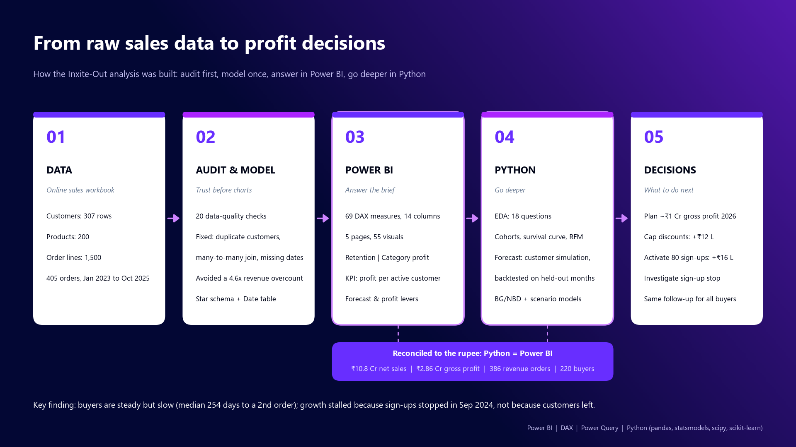
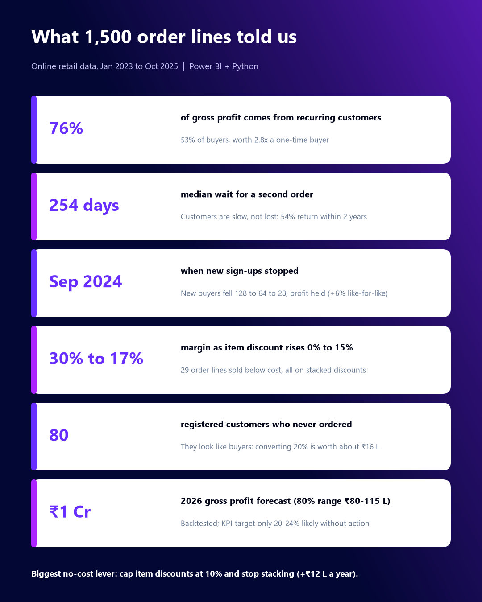
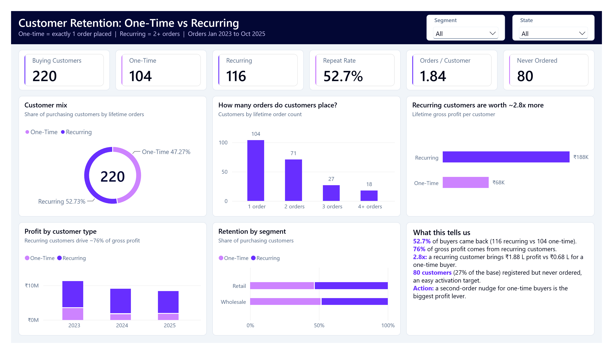
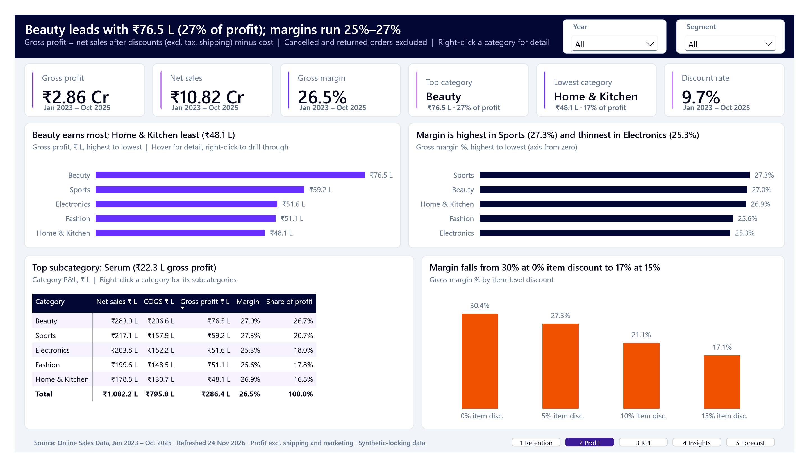
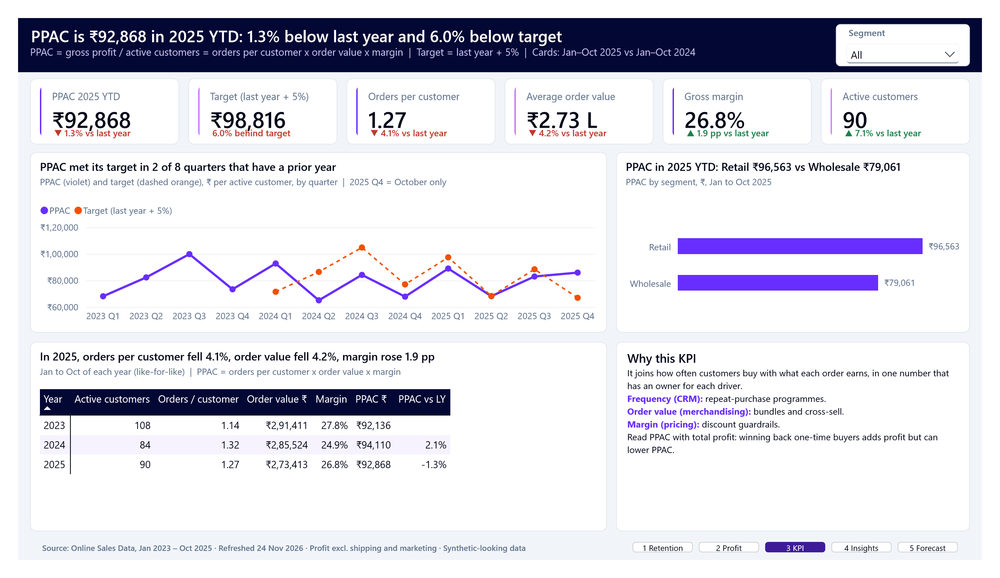
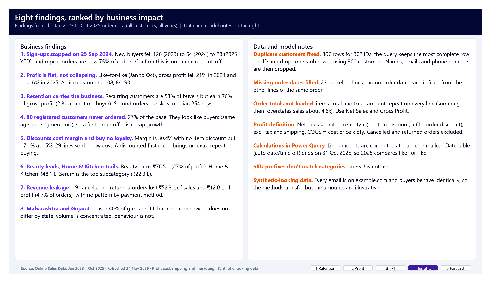
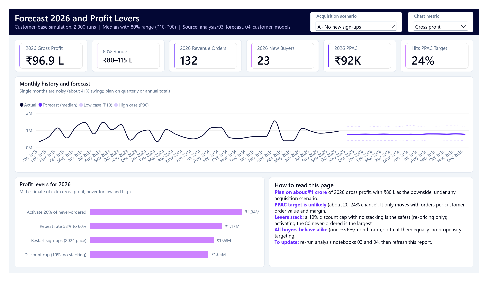

# RetailPulse-PBI: Customer Retention, Profitability and 2026 Forecast

An end-to-end analysis of an online retail business (1,500 order lines, 405 orders, Jan 2023 to Oct 2025), built in **Power BI** and **Python**.
It answers three business questions, audits the data, explores it, forecasts 2026 and sizes the profit levers.



---

## The brief, answered

| Question | Answer |
|---|---|
| **1. One-time vs recurring customers** | 104 one-time and 116 recurring (52.7% repeat rate). Recurring customers generate **76% of gross profit**, about **2.8x** a one-time buyer. |
| **2. Profit by product category** | Beauty ₹76.5 L (27%), Sports ₹59.2 L, Electronics ₹51.6 L, Fashion ₹51.1 L, Home & Kitchen ₹48.1 L. Margins sit at 25–27%; Electronics is the thinnest. |
| **3. A KPI linking behaviour and profit** | **Profit per Active Customer (PPAC)** = orders per customer × average order value × gross margin. 2025 YTD: ₹92,868, 6% below its target (last year + 5%). |

## Key findings



1. **Sign-ups stopped on 25 Sep 2024.** New buyers fell 128 → 64 → 28, yet like-for-like (Jan–Oct) profit rose 6% in 2025. The customer base is healthy; the funnel is empty.
2. **Customers return slowly but steadily.** The median gap to a second order is 254 days, and 54% return within 2 years. Silence is not churn.
3. **Every buyer behaves alike.** Repeat buying follows a single shared rate of about 3.6% a month (dispersion test 1.03), so propensity scores and churn flags have no predictive power here.
4. **Discounts cost margin and buy no loyalty.** Margin is 30% at 0% item discount and 17% at 15%. All 29 loss-making lines stack two discounts, and a discounted first order does not raise repeat rates.
5. **2026 forecast: about ₹1 crore of gross profit** (80% range ₹80–115 L), from a customer-level simulation backtested on held-out months. Chance of hitting the PPAC target without action: 20–24%.

### Profit levers for 2026

| Lever | Gross profit uplift | Cost |
|---|---|---|
| Cap item discounts at 10%, no stacking | +₹9–12 L | None |
| Convert 20% of the 80 never-ordered sign-ups | +₹11–16 L | Low |
| Raise repeat rate 53% → 60% | +₹12 L (lowers PPAC, so read the KPI with total profit) | Low–medium |
| Restart sign-ups at the 2024 pace | +₹11 L | Marketing spend |

---

## Power BI report

Five pages in the InXiteOut palette (navy `#030734`, violet `#682EFF`, lilac `#CD83FF`):

| Page | What it shows |
|---|---|
| 1. Customer Retention | One-time vs recurring counts, order-frequency mix, profit per customer, retention by segment |
| 2. Category Profitability | Profit and margin by category, category/subcategory P&L, margin by discount level |
| 3. KPI: Profit per Customer | PPAC vs target, quarterly trend, driver decomposition |
| 4. Key Insights | Business findings and data/model notes |
| 5. Forecast & Levers | 2026 scenarios with P10–P90 bands, profit levers |

| | | |
|---|---|---|
|  |  |  |
|  |  | |

**Model:** star schema (`Order_Items` fact; `Customers`, `Products`, `Date` dimensions) with 69 DAX measures in a `_Measures` table, organised by folder.

**Data fixes in Power Query:**
- Deduplicate customers, keeping the most complete row.
- Drop one stub record.
- Fill missing order dates from their own order.

**Profit definition:** net sales = unit price × quantity × (1 − item discount) × (1 − order discount), excluding tax and shipping. COGS = cost price × quantity. Cancelled and returned orders are excluded.

## Python analysis

| Notebook | Questions | Report |
|---|---|---|
| `00_load_clean` | Loads, cleans, and **asserts totals match Power BI** | — |
| `01_audit` | Q1–18: 20 data-quality checks | [audit_report.md](analysis/audit_report.md) |
| `02_eda` | Q19–36: trends, cohorts, survival curve, RFM, basket, discounts | [eda_report.md](analysis/eda_report.md) |
| `03_forecast` | Q37–42: customer-base simulation, backtest, scenarios | [forecast_report.md](analysis/forecast_report.md) |
| `04_customer_models` | Q43–48: BG/NBD, Gamma-Gamma CLV, churn test, lever scenarios | [customer_models_report.md](analysis/customer_models_report.md) |

All 48 questions are listed in [analysis_questions.md](analysis_questions.md). Business rules live in one place, [`analysis/src/metrics.py`](analysis/src/metrics.py), and mirror the DAX definitions.

---

## Repository layout

```
RetailPulse-PBI.pbip            Power BI project (open this in Power BI Desktop)
RetailPulse-PBI.SemanticModel/  Model as TMDL: tables, DAX measures, Power Query, relationships
RetailPulse-PBI.Report/         Report as PBIR JSON: pages, visuals, theme
analysis/                       Notebooks, reports, shared metrics module, outputs and figures
_build/                         Scripts that generate the report pages, measures and LinkedIn visuals
docs/                           Approach diagram, insights card, dashboard images, LinkedIn post
```

## How to run

**Data.** The source workbook `Online Sales Data.xlsx` is not committed. Put it in `data/` (or set `INXITE_RAW_XLSX`) for Python.

**Power BI.**
1. Open `RetailPulse-PBI.pbip` in Power BI Desktop (Developer Mode / PBIP support).
2. In **Transform data → Manage Parameters**, set `ProjectFolder` to the folder you cloned this repo into, and `SourceWorkbook` to the full path of your copy of the workbook. Every query reads its path from these two parameters.
3. Refresh.

**Python.**

```bash
pip install -r requirements.txt
cd analysis
jupyter nbconvert --to notebook --execute --inplace 00_load_clean.ipynb 01_audit.ipynb 02_eda.ipynb 03_forecast.ipynb 04_customer_models.ipynb
```

The notebooks are generated by the `_make_*.py` scripts, so edit those and rebuild rather than editing the notebooks directly.

## Caveats

- The dataset shows signs of being **synthetic**: every email is on `example.com`, tax rates vary randomly within a product type, SKU prefixes don't match categories, and buyers are statistically identical. The methods transfer to real data; the specific numbers are illustrative.
- Customer-level outputs (names, scores) are excluded from the repository on purpose.

## Tools

Power BI Desktop (DAX, Power Query, TMDL/PBIR) · Python (pandas, NumPy, SciPy, statsmodels, scikit-learn, matplotlib, seaborn) · Jupyter
